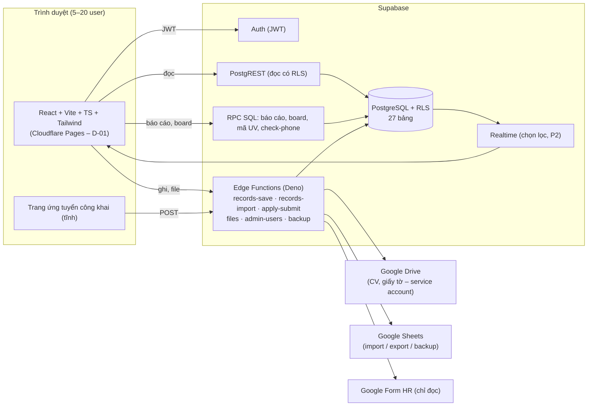

# ARCHITECTURE – Nâng cấp hệ thống tuyển dụng (TA Tracker)

Trạng thái: **v1.0 – ĐÃ DUYỆT (cổng G1, 19/11/2026, theo phiếu G1 của PO)** · Ngày: 19/11/2026 · Người soạn: Claude (Architect/Reviewer)
Nguồn đã đọc: `Ke_hoach_nang_cap…docx`, `AUDIT.md` (18/11), `CON_LAI_CAN_LAM.md`, `apps-script/*.gs` (Core, Api, Api2, Forms, Ops, Docs, HrInfo, HrForm, Pipeline, Apply, Schema, Setup), `src/shared/*.ts`, `src/services/dataService.ts`, `src/App.tsx`. **Chưa đọc kỹ**: các component React (`src/components/*`), `Shared.gs`, `Index.html` (bundle sinh tự động), dữ liệu thật. Những chỗ suy ra từ tên file/route được đánh dấu *(chưa xác minh)*.

---

## 1. Kết luận audit (tóm tắt)

1. Hệ thống hiện tại **không phải bản Apps Script thô**: frontend đã là React 19 + Vite + TypeScript + Tailwind, đóng gói inline vào Apps Script. Phần cần thay là **backend + lưu trữ** (Sheets làm DB, cache, lock, workspace/TA). Logic nghiệp vụ nằm trong `src/shared/*.ts` đã dùng chung client/server → **tái sử dụng được nguyên si**.
2. Vấn đề gốc (AUDIT.md §6): id = vị trí dòng, ghi kép workspace + Master không giao dịch, cache chứa "sự thật" không dựng lại được, một lock toàn cục, schema theo vị trí cột, log phình trong cùng file. Tất cả đều biến mất khi chuyển sang PostgreSQL (giao dịch, khóa ngoại, index, RLS) – **không cần port các cơ chế vá đó**.
3. Quy mô dữ liệu thật: ~9.233 hồ sơ hợp lệ trong lần test 17/11 (mục tiêu 20.000), 31 PIC, 89 cột Master (4 meta + 82 field + 3 cột sync).
4. Có **5 điểm kế hoạch (docx) lệch với thực tế code** – cần duyệt trước khi chốt schema (mục 2).
5. Có **2 rủi ro chặn "zero-budget"** cần quyết định ngay (mục 7): Vercel Hobby cấm dùng thương mại; Supabase Free tự pause sau 1 tuần không hoạt động và không có backup tự động.

---

## 2. Điểm lệch giữa kế hoạch và thực tế (PO đã duyệt theo cột "Đề xuất", G1 19/11/2026)

| # | Kế hoạch (docx) | Thực tế trong source | Đề xuất |
|---|---|---|---|
| L1 | Bảng `applicants` (con người) tách `recruitment_records` (lần ứng tuyển) | Một dòng Candidates = một lần ứng tuyển; thông tin định danh nằm cùng dòng. 1.385 hồ sơ trùng SĐT với hồ sơ khác, 41 cặp cùng mã khác người | Giữ `recruitment_records` mang **snapshot định danh** như hiện nay; `applicants` chỉ là bảng **liên kết** (xem D-04). Lý do: nếu sửa định danh trên bảng dùng chung thì TA này sửa được dữ liệu hồ sơ của TA khác, phá RLS |
| L2 | Bảng `interview_rounds` gồm R1, SU, LU, R2 | R1/R2/OB là **cột** trên hồ sơ (`r1_date/time/status/sub_status/note`, `r2_*`, `ob_*`). SU/LU **không phải vòng**, chỉ là ô Kanban suy ra (`pipelineRules.ts`). Lịch sử phỏng vấn thêm tay nằm ở sheet `Interviews` | Giữ cột R1/R2/OB trên `recruitment_records` (giữ nguyên KPI/validation). `interview_schedules` thay `Interviews`. Không tạo `interview_rounds` |
| L3 | `users`, `ta_profiles` tách riêng | `Users` có `role` (admin/pic) + `pic_code`; PIC là danh mục dropdown; `Workspaces` gắn PIC với file Sheet | `profiles` (1–1 với `auth.users`) gồm role + pic_code. `ta_profiles` = bảng danh mục PIC (`pics`) |
| L4 | Danh sách bảng gồm 11 bảng | Source còn: Comments, Tasks, Hiring (checklist), Targets, CalendarEvents, HrInfo, HrFormSends, Attachments, Translations, Applications (form công khai), Views, Dropdowns/SubSource/Hierarchy/Requests, Forms/Submissions/FormTemplate, cấu hình (Properties) | Schema đề xuất 27 bảng (xem DATABASE_SCHEMA.md) |
| L5 | Google Sheets chỉ import/export | Hiện còn dùng Sheets cho **workspace mỗi TA** (30 file), sheet trả lời Google Form HR, Drive cho CV/giấy tờ | Workspace **bỏ hẳn**. File (CV, giấy tờ) **giữ ở Google Drive** (D-03). Sheet Google Form HR: giữ đọc theo yêu cầu (D-08) |

---

## 3. Chức năng phải giữ nguyên

Cột "Xử lý": **G** giữ nguyên hành vi · **T** giữ chức năng, thay cơ chế · **B** bỏ (không còn cần) · **?** cần PO quyết.

| Module | Chức năng (nguồn) | Xử lý |
|---|---|---|
| Đăng nhập | login/logout/me/đổi MK; 8 lần sai/10 phút; phiên 6h; role admin/pic (`Api.gs`, `Core.gs`) | T (Supabase Auth; rate-limit ở Auth) |
| Ứng viên – danh sách | lọc, tìm (mã/tên/SĐT), phân trang, View đã lưu, tùy chỉnh cột theo người dùng, nhãn trùng SĐT/CCCD, 6 thẻ KPI bấm để lọc, kéo dòng vào thẻ để chuyển bước (`CandidateTableView`, `PipelineKpiStrip`) | G |
| Ứng viên – chi tiết/nhập | 11 section, 82 field, nhập nhanh (section 1–3), validate dùng chung, field tự tính (source, ob_month, tenor), mã UV tự sinh theo PIC, check-phone, lưu trữ/khôi phục, `row_version` chống ghi đè (409) | G (validate: D-02) |
| Khóa theo vòng rớt | R1 Failed / R2 Failed,Canceled / OB Canceled,Noshow ⇒ khóa các section sau (`pipelineRules.lockedFieldKeys`) | G |
| Quy tắc trạng thái–lý do | `reasonRules.ts` (r1/r2/ob), chỉ cảnh báo khi thiếu lý do | G |
| Kanban | 5 cột Lead/R1/LU-SU/R2/OB, 30 thẻ/cột + "Tải thêm", chỉ kéo tiến, hộp xác nhận, ghi `STAGE_MOVE`, lọc PIC/vị trí/khu vực (`Pipeline.gs`, `KanbanBoardView`) | G |
| CV & giấy tờ | CV (≤5MB), giấy tờ 5 loại, tên file theo quy tắc `documentRules.ts`, Salary Proposal (Rank ≥5), Payslips (≤20 file, ≤10MB) | T (file ở Drive) |
| Dịch & tạo CV | bản dịch EN `experience_summary` có hash nguồn; Tạo CV mẫu CV-EN-1 (client, in PDF) | G |
| Thông tin nhân sự (HR Info) | chỉ khi R2 Passed trở đi; draft → submitted → verified; trùng CCCD; link Google Form công ty + tra cứu phản hồi (`HrInfo.gs`, `HrForm.gs`) | G (nguồn trả lời Form: D-08) |
| Công việc (Tasks) | CRUD, loại/ưu tiên, owner, due, Admin giao việc | G |
| Lịch phỏng vấn / Calendar | Interviews theo hồ sơ + sự kiện tự tạo; xem ngày/tuần/tháng/danh sách | G |
| Hiring checklist | 6 mục (3 tay, 3 tự tính); Xác nhận tuyển ⇒ OB Status = Accepted và khóa, Admin mở lại | G |
| Alerts | quá hạn, sắp hạn, R2 passed chưa có HR info, offer thiếu giấy tờ | G |
| Target | ngày/tuần/tháng/năm × PIC/vị trí/phòng ban; thực tế = OB Joined theo ngày OB. **Đổi quyền xem (G1):** TA chỉ xem target của mình; Admin bật quyền xem tất cả cho từng TA | G + quyền mới |
| Báo cáo/Dashboard | 19 trường ReportRow, `dashboardCalc.ts` (leads, R1, LU, SU, R2, OB, NS, CC, ER, ATT, ER30/60), FollowWD, biểu đồ, export | T (tính ở SQL, D-06) |
| Bình luận | thêm/sửa/xóa theo hồ sơ | G |
| Import Excel | theo chunk, chuẩn hóa legacy (`applyLegacyImportTransformations`), báo lỗi theo dòng | G |
| Quản trị | Users, Drop-list (+đề xuất giá trị, phân cấp Region→Location→Site, SubSource→Source), Views, Audit log, cấu hình (ob-target, hr-form) | G |
| Form ứng tuyển công khai | link riêng mỗi TA + link chung; chống spam (SĐT 1 lần/10 phút, ≤120/giờ/link, honeypot); inbox; tạo hồ sơ/bỏ qua; trang tĩnh trên tên miền công ty (`Apply.gs`, `dist-apply`) | T (Edge Function) |
| i18n | Việt/Anh toàn UI | G |
| Workspace/Sync/SyncLog/Diag/schema-check/bàn giao workspace | cơ chế vá cho Sheets | **B** |
| Form nhập riêng mỗi TA (`?form=<code>`), Submissions, FormTemplate | link nhập riêng có phiên bản | **B** (D-09a) |
| `hFunnel_`, nhánh Node trong `dataService.ts`, `code_cho_AI/` | code chết | **B** |

### 3.1 Quy tắc nghiệp vụ phải bảo toàn (golden tests)

Mỗi quy tắc dưới đây phải có test đối chiếu với bản cũ trên cùng dữ liệu mẫu:

- `stage.ts: currentStage` (9 giai đoạn) và `pipelineRules.ts: boardPosition / boardSub / moveChanges` (5 ô, 8 chỉ số phụ, chỉ kéo tiến).
- `reasonRules.ts` (trạng thái → lý do hợp lệ), `REASON_RENAMES` chỉ dùng khi import legacy.
- `validation.ts`: chuẩn hóa SĐT (`normalizeAndValidatePhone`), ngày (ISO), `normalizeBirth`, `normalizeCvLink`, `computeSourceFromSubSource`, `computeObMonth`, `computeTenor`, `validateAndComputeCandidate`.
- `candidateCode.ts`: mã = tiền tố PIC + "00" + số tăng dần, bỏ qua mã đã dùng.
- `documentRules.ts`: giấy tờ bắt buộc theo vị trí/rank, vị trí xe nâng.
- `dashboardCalc.ts: totals / rates / trend / retention` – định nghĩa KPI đã thống nhất; **không đổi công thức** khi chuyển sang SQL (đối chiếu số trên cùng tập dữ liệu, sai lệch = 0).
- Mặc định đang dùng tạm (CON_LAI_CAN_LAM.md "Cần bạn chốt"): "đã đạt vòng 2", ô LU/SU, ai xem lương/CCCD/ngân hàng, giới hạn file, xác nhận tuyển, "Thực tế" của Target. Chuyển nguyên trạng, không tự đổi.

---

## 4. Kiến trúc đích

### 4.1 Đường đọc / đường ghi

- **Đọc**: frontend gọi PostgREST trực tiếp (RLS lọc theo PIC), chỉ chọn cột cần thiết, phân trang phía server (keyset hoặc range ≤100). Báo cáo/KPI/board chạy bằng **RPC SQL** trả số đã tổng hợp, không kéo 20.000 dòng về trình duyệt (khác `reports/rows` hiện tại ~11 MB).
- **Ghi hồ sơ**: duy nhất qua Edge Function `records-save`. Hàm: (1) xác thực JWT, (2) nạp cấu hình drop-list, (3) chạy **cùng module** `src/shared/validation.ts` + `pipelineRules.ts` + `reasonRules.ts`, (4) gọi RPC `public.save_record(...)` bằng JWT của người dùng để RLS áp dụng. RPC thực hiện trong **một giao dịch**: kiểm `row_version`, ghi hồ sơ, `status_history`, `audit_log`. Không có ghi kép, không có cache cần đồng bộ.
- `INSERT/UPDATE/DELETE` trực tiếp trên `recruitment_records` bị **thu hồi** với role `authenticated` – chỉ RPC (SECURITY INVOKER) ghi được. Các bảng nhỏ (tasks, comments, events, targets…) cho ghi trực tiếp qua PostgREST + RLS + CHECK/trigger.
- **File**: Edge Function `files` nhận/phát file, ghi vào Drive bằng service account, lưu `drive_file_id` + metadata trong `record_files`. Kiểm tra quyền xem hồ sơ trước khi trả file (sửa lỗ hổng "TA thiếu PIC" – AUDIT §3.2 #1).
- **Realtime**: không bật mặc định. P2: kênh theo `recruitment_records` đã lọc theo PIC để Kanban tự làm mới. Giới hạn Free: 200 kết nối đồng thời – đủ cho 20 user.

### 4.2 Ánh xạ thành phần cũ → mới

| Cũ | Mới |
|---|---|
| Master sheet `Candidates` | `recruitment_records` |
| 30 workspace + `wsSync_` + `SyncLog` | RLS theo `pic_code` (không còn bản sao) |
| `CacheService` snapshot/patch | Index PostgreSQL + RPC; không cache nghiệp vụ |
| `LockService` toàn cục | Giao dịch + `row_version` theo hàng |
| id = vị trí dòng | `id bigint identity`; `legacy_id` giữ id cũ để nối Comments/Tasks khi migrate |
| `Audit` sheet (1 dòng/trường đổi) | `audit_logs` (1 dòng/lần lưu, diff JSONB), có chính sách lưu trữ |
| `PropertiesService` (cols_<uid>, ob-target, hr-form…) | `user_preferences`, `app_settings` |
| bcrypt trong `Users` | Supabase Auth (D-05) |
| `Index.html` bundle inline | build Vite chuẩn, deploy tĩnh |

---

## 5. Quyết định kiến trúc (ADR rút gọn)

| ID | Vấn đề | Phương án | Khuyến nghị | Ai chốt |
|---|---|---|---|---|
| D-01 | Hosting frontend | (a) Vercel Hobby – **cấm thương mại**; (b) Cloudflare Pages Free – cho phép thương mại, băng thông không giới hạn, 500 build/tháng; (c) Vercel Pro $20/user/tháng | **(b)** để giữ 0 đồng đúng điều khoản. Kế hoạch ghi Vercel nên cần PO đồng ý đổi, hoặc chấp nhận chi phí (c) | **PO đã chốt 19/11/2026: (b) Cloudflare Pages** |
| D-02 | Nơi chạy validation | (a) chỉ client; (b) Edge Function dùng chung module TS; (c) viết lại bằng PL/pgSQL | **(b)**: một nguồn sự thật như hiện nay (`Shared.gs` sinh từ TS). (a) bypass được bằng API; (c) trùng logic, lệch dần | Claude → PO duyệt |
| D-03 | Lưu file CV/giấy tờ | (a) Drive (giữ); (b) Supabase Storage (Free 1 GB) | **(a)**: 20.000 hồ sơ × CV ≤5 MB vượt 1 GB rất nhanh. Cần service account + chủ sở hữu Drive là tài khoản hệ thống (đã nằm trong việc "bạn cần làm" #3) | **PO đã chốt 19/11/2026: (a) Google Drive** |
| D-04 | Mô hình người/lần ứng tuyển | (a) Chỉ `recruitment_records`; (b) thêm `applicants` làm bảng **liên kết** (id, `phone_norm`, tên chuẩn hóa), records giữ snapshot; (c) `applicants` mang định danh dùng chung | **(b)**. (c) làm rò/sửa chéo giữa TA. Quy tắc gộp: cùng `phone_norm` hợp lệ **và** cùng tên chuẩn hóa ⇒ cùng `applicant_id`; còn lại tách; nhóm nghi ngờ xuất báo cáo cho PO duyệt, **không tự gộp** | **PO đã chốt 19/11/2026: (b) bảng liên kết, gộp có điều kiện** |
| D-05 | Danh tính đăng nhập | (a) Email thật; (b) email giả `<username>@ta.supra.internal` + mapping username; (c) import bcrypt hash | **(b)** giữ trải nghiệm username. Thử (c) trên dev (GoTrue dùng bcrypt); nếu không tương thích thì cấp mật khẩu tạm + bắt đổi | **PO đã chốt 19/11/2026: (b) username + email giả** |
| D-06 | Tính KPI/báo cáo | (a) kéo dòng về client như cũ; (b) SQL/RPC trả số tổng hợp + bảng chi tiết phân trang | **(b)**; `dashboardCalc.ts` giữ làm **oracle test** (so số, không dùng ở runtime cho Admin) | Claude |
| D-07 | Field tự tính phụ thuộc ngày hiện tại (`tenor`) | (a) lưu khi ghi (cũ, bị cũ dần); (b) tính khi đọc (view) | **(b)** cho `tenor`; `source`, `ob_month` lưu khi ghi | Claude |
| D-08 | Sheet trả lời Google Form HR | (a) giữ đọc qua Sheets API; (b) bỏ, nhập thẳng vào HR Info | **(a)** ở P1 (không đổi quy trình HR); P3 xem lại | **PO đã chốt 19/11/2026: (a) giữ đọc sheet ở P1** |
| D-09 | Form nhập riêng mỗi TA + Submissions | (a) bỏ (nhập ngay trong app); (b) port | **? chưa đủ thông tin** – mục đích nghiệp vụ gốc là TA nhập từ link riêng; nếu TA đã dùng app trực tiếp thì **(a)** | **PO đã chốt 19/11/2026: (a) bỏ** |
| D-10 | Audit | (a) 1 dòng/trường như cũ; (b) 1 dòng/lần lưu + diff JSONB; lưu 12 tháng rồi xuất Drive/xóa | **(b)** để ở dưới 500 MB (mục 7) | Claude |
| D-11 | Realtime | tắt mặc định | bật chọn lọc ở P2 | Claude |
| D-12 | Backup và chống pause trên Supabase Free | (a) chỉ Sheets; (b) chỉ `pg_dump`; (c) cả hai | **(c) – PO đã đồng ý 19/11/2026.** Một workflow hằng ngày: truy vấn giữ hoạt động → `pg_dump` mã hóa → đẩy ra Drive; Edge `backup` xuất Sheets hằng ngày. Có cảnh báo khi lỗi. Thử restore trước nghiệm thu | PO (đã duyệt) |
| D-13 | Đăng nhập | tài khoản do Admin cấp, tắt đăng ký tự do | **PO đã xác nhận 19/11/2026.** Khớp D-05 (username → email giả) và Edge `admin-users` | PO (đã duyệt) |

---

## 6. Bảo mật – mô hình tin cậy

- Trình duyệt chỉ giữ **anon key + JWT**. `service_role` và khóa Google service account chỉ nằm trong **Supabase Edge Function secrets**.
- RLS bật trên **mọi** bảng trong schema `public`; mặc định từ chối. Chi tiết chính sách: DATABASE_SCHEMA.md §5.
- Dữ liệu nhạy cảm (CCCD, tài khoản ngân hàng, lương, mã số thuế, BHXH – HR Info + `basic_salary`…) áp dụng cùng quy tắc "Admin + TA phụ trách" như hiện tại; **không** cho PostgREST đọc cột nhạy cảm của bảng khác PIC. Mã hóa thêm `hr_info.data`/lương ở tầng ứng dụng: **không làm ở giai đoạn 1** (Q9a), dựa vào RLS + backup mã hóa; xem lại ở P2.
- Chống lạm dụng form công khai: Edge Function `apply-submit` (honeypot, giới hạn theo SĐT/link/IP trong bảng `rate_limits`, kiểm tra MIME/kích thước ≤5 MB, quét đuôi file). Không cấp quyền `anon` ghi trực tiếp vào bảng.
- Chống formula injection khi export: giữ `sanitizeCellForSpreadsheet`.
- Ghi log đăng nhập/truy cập file tải về (hiện có "tải xuống ghi nhật ký").
- Dữ liệu cá nhân (CCCD, ngân hàng, mã số thuế…) đặt trên dịch vụ nước ngoài: nghĩa vụ theo Nghị định 13/2023/NĐ-CP (vùng đặt dữ liệu, đánh giá tác động, thỏa thuận xử lý). **PO chấp nhận rủi ro và ghi nhận bằng văn bản (phiếu G1 19/11/2026, Q10b)**, không chờ pháp chế/DPO xác nhận. Claude không kết luận về mặt pháp lý.

---

## 7. Hạn mức free tier và rủi ro vận hành (đã tra cứu 19/11/2026)

| Dịch vụ | Hạn mức Free (theo trang giá/tài liệu) | Tác động với hệ thống này | Rủi ro / giảm thiểu |
|---|---|---|---|
| Supabase | 500 MB DB, 5 GB egress (+5 GB cached), 50.000 MAU, 1 GB file, 2 project active, 200 kết nối Realtime, 500.000 Edge invocations; **project pause sau 1 tuần không hoạt động**; không có backup tự động/PITR | DB: ước tính 20.000 hồ sơ ≈ 40–80 MB (chưa đo). Audit 1 dòng/lần lưu ≈ 250.000 dòng/năm ≈ 60–100 MB/năm (ước tính từ AUDIT §6 #7). Egress ước tính ≈ 1–2 GB/tháng **nếu** chọn cột và phân trang; nếu để tải full dòng 89 cột sẽ tiến sát 5 GB | **Pause**: kỳ nghỉ Tết >7 ngày sẽ làm app chết ⇒ cần cron ping hoặc nâng Pro. **Backup**: đã chốt D-12 – `pg_dump` hằng ngày (GitHub Actions) ra Drive + export Sheets hằng ngày; thử restore trước nghiệm thu. Nhật ký lưu 1 ngày |
| Vercel Hobby | 100 GB băng thông, 1M edge requests; **chỉ cho mục đích cá nhân phi thương mại** | Công cụ nội bộ của doanh nghiệp là thương mại ⇒ vi phạm điều khoản, có thể bị khóa không báo trước | Dùng Cloudflare Pages (D-01) hoặc Vercel Pro |
| Cloudflare Pages Free | không giới hạn băng thông/yêu cầu tĩnh, 500 build/tháng, 20.000 file/site, cho phép thương mại; Pages Functions tính vào hạn mức Workers (100.000 req/ngày) | Chỉ host tĩnh – đủ | 500 build/tháng ≈ 16/ngày: bật preview có kiểm soát |
| Google Drive/Sheets API | quota theo project (số cụ thể *chưa xác minh*) | Chỉ dùng cho file + import/export | Gom batch, không gọi trong vòng lặp |
| GitHub | Actions free cho repo private có giới hạn phút (*chưa xác minh*) | Chạy backup/keep-alive/CI | Theo dõi phút dùng |

Nguồn tra cứu: supabase.com/pricing, vercel.com/docs/plans/hobby, developers.cloudflare.com/pages/platform/limits (cùng một số bài so sánh 2026). **Phải kiểm lại trước khi triển khai**; kế hoạch gốc cũng yêu cầu như vậy. Kết luận trung thực: **"0 đồng, vận hành lâu dài, ổn định" không đạt được trọn vẹn trên Supabase Free** nếu hệ thống phải chạy liên tục có dữ liệu cá nhân và cần backup; phương án nâng cấp tối thiểu là Supabase Pro $25/tháng (không pause, 8 GB, backup hằng ngày 7 ngày – theo trang giá).

### 7.1 Rủi ro khác

| Rủi ro | Mức | Giảm thiểu |
|---|---|---|
| Lệch KPI giữa SQL và `dashboardCalc.ts` | Cao | Golden test trên dữ liệu thật đã ẩn danh; chạy song song 2 tuần |
| Dữ liệu migrate sai (id lệch, bản "ma" trong workspace) | Cao | Đóng băng → `sync-all` → export Master → đối chiếu; báo cáo ngoại lệ (MIGRATION_PLAN) |
| Edge Function cold start làm lưu hồ sơ chậm | Trung bình | Đo; mục tiêu Kanban P95 <1 s dựa vào optimistic UI (đã có trong tiêu chí nghiệm thu) |
| RLS cấu hình sai (rò dữ liệu giữa TA) | Cao | Bộ test RLS bằng ≥3 tài khoản PIC + Admin; chặn merge nếu fail |
| TA thiếu `pic_code` | Trung bình | `CHECK (role='admin' OR pic_code IS NOT NULL)` ở `profiles` |
| Phụ thuộc Drive service account | Trung bình | Tài khoản hệ thống riêng, chủ sở hữu thư mục là tài khoản đó |
| Mất dữ liệu do xóa nhầm | Trung bình | Lưu trữ mềm (`is_archived`), không `DELETE` hồ sơ; backup định kỳ |

---

## 8. Phạm vi không làm (non-goals)

Không viết lại UI từ đầu; không đổi quy tắc nghiệp vụ/KPI; không nối Outlook/Google Calendar; không xóa dữ liệu cũ (hệ Apps Script giữ ở chế độ chỉ đọc đến khi nghiệm thu).

## 9. Điều kiện duyệt trước khi giao Antigravity

**Đã đạt 19/11/2026.** PO trả lời D-01, D-03, D-04, D-05, D-08, D-09 và Q1–Q10 qua phiếu G1; tài liệu lên **v1.0**. Mọi thay đổi schema/API từ nay ghi vào mục "Nhật ký thay đổi" cuối từng tài liệu và chờ duyệt.

## 10. Câu hỏi mở – đã trả lời (G1)

| # | Câu hỏi | Mặc định tạm (trước G1) | **Quyết định PO (G1)** |
|---|---|---|---|
| Q1 | Chủ trương hosting: đổi sang Cloudflare Pages hay chấp nhận Vercel Pro? | Cloudflare Pages | Cloudflare Pages (D-01b) |
| Q2 | Supabase Pro hay Free + backup tự dựng? | **ĐÃ CHỐT 19/11/2026 (PO): Free + 2 lớp backup (Sheets hằng ngày + `pg_dump` hằng ngày) + job giữ hoạt động (D-12)** | Free + 2 lớp backup (D-12) |
| Q3 | Form nhập riêng mỗi TA (`?form=`) còn dùng không? (D-09) | Bỏ | Bỏ (D-09a) |
| Q4 | Quy tắc gộp `applicants` (D-04) có đồng ý không? | Cùng SĐT hợp lệ + cùng tên chuẩn hóa | Đồng ý: cùng SĐT hợp lệ + cùng tên chuẩn hóa; nhóm nghi ngờ PO duyệt |
| Q5 | 596 dòng lỗi dữ liệu gốc (kho không thuộc tỉnh, R2_Sub "Định hướng", R1 "Canceled"…) sẽ sửa ở nguồn hay nới quy tắc? (CON_LAI_CAN_LAM Phase 7) | Không nạp dòng lỗi; xuất báo cáo cho PO | Không nạp, xuất báo cáo để sửa ở nguồn (Q5a) |
| Q6 | Đổi PIC: Comments/Tasks/Interviews của hồ sơ có đi theo hồ sơ không? (AUDIT §4.1 chưa rõ chủ ý) | Đi theo hồ sơ; TA cũ mất quyền xem (RLS tự xử lý) | Đi theo hồ sơ; TA cũ mất quyền xem |
| Q7 | Thời hạn lưu `audit_logs` | 12 tháng online, sau đó xuất Drive | 12 tháng online, sau đó xuất Drive |
| Q8 | Dữ liệu mẫu đã ẩn thông tin cá nhân + ảnh chụp màn hình + quy tắc phân quyền Admin/TA chi tiết (mục 9 kế hoạch) – khi nào có? | Dùng dữ liệu seed của harness test | Tạm dùng seed của bộ test cũ |
| Q9 | Mã hóa thêm cột HR Info/lương ở tầng ứng dụng? | Không ở P1 | Không ở giai đoạn 1 |
| Q10 | Nghĩa vụ pháp lý dữ liệu cá nhân (mục 6) – ai xác nhận? | Pháp chế/DPO của Masan | PO chấp nhận rủi ro, ghi nhận bằng văn bản (không chờ pháp chế) |

### 10.1 Quyết định phát sinh khi duyệt G1

| # | Nội dung | Quyết định PO |
|---|---|---|
| E1 | 41 dòng trùng mã ứng viên | Không nạp dòng sau; TA cấp mã mới ở nguồn theo quy tắc mã PIC |
| DEV-DATA | Dữ liệu thật (9.829 hồ sơ) đang nằm trên project DEV | Thay bằng bản đã ẩn thông tin cá nhân; **PO chọn làm sau** (việc M8-0) |
| TARGET | TA có xem target của TA khác không | Không, TA chỉ xem target của mình; Admin bật quyền xem tất cả cho từng TA (`profiles.can_view_all_targets`) |
| DOC | Đính chính tài liệu | Đồng ý: RLS chỉ `enable`; RPC gọi từ app ở schema `public`, `app` chỉ chứa `is_admin`/`my_pic`/`can_see_record`; migration đã áp dụng không sửa; `import_batches` dùng `source`; ghi nhận `0004_service_role_grants` |

## 11. Nhật ký thay đổi

| Phiên bản | Ngày | Nội dung |
|---|---|---|
| 0.1 | 19/11/2026 | Bản nháp đầu từ audit |
| 0.2 | 19/11/2026 | PO chốt Q2 (Free + 2 lớp backup), thêm D-12, D-13 |
| 1.0 | 19/11/2026 | Duyệt G1: chốt D-01b, D-03a, D-04b, D-05b, D-08a, D-09a, Q1–Q10; thêm §10.1 (E1, DEV-DATA, TARGET, DOC); RPC `save_record` ở `public`; Q9a, Q10b vào §6 |
