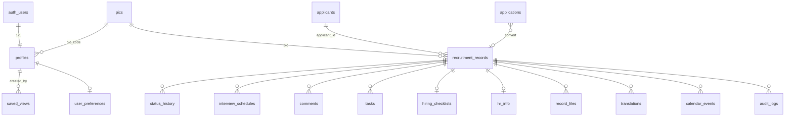

# DATABASE_SCHEMA – PostgreSQL (Supabase)

Trạng thái: **v1.0 – ĐÃ DUYỆT (cổng G1, 19/11/2026)**. Quyết định áp dụng: D-04 (b), D-05 (b), D-09 (a – bỏ form riêng), Q7 (12 tháng), TARGET (TA chỉ xem target của mình, Admin cấp thêm quyền xem). Đây là **thiết kế**; migration thực tế nằm ở `supabase/migrations/` – migration đã áp dụng **không sửa**, thay đổi mới tạo file số tiếp theo. Mọi thay đổi sau duyệt ghi ở mục "Nhật ký thay đổi".

Quy ước schema: RLS chỉ `enable` (không `force`). RPC gọi từ app nằm trong schema `public`; schema `app` chỉ chứa hàm hỗ trợ RLS (`is_admin`, `my_pic`, `can_see_record`).

Nguyên tắc: giữ nguyên 82 field và quy tắc hiện có; khóa chính ổn định; không dùng SĐT làm khóa; mọi bảng `public` bật RLS; ghi hồ sơ chỉ qua RPC; tên cột = `key` trong `FIELD_CATALOG` để mapping import/export một–một.

---

## 1. Danh sách bảng (27)

| # | Bảng | Thay cho (sheet cũ) | Ưu tiên | Ghi chú |
|---|---|---|---|---|
| 1 | `profiles` | Users | P0 | 1–1 `auth.users`; role + `pic_code` |
| 2 | `pics` | dropdown `pic` | P0 | danh mục PIC/TA |
| 3 | `dropdown_options` | Dropdowns | P0 | `(list_key, value)` |
| 4 | `sub_source_map` | SubSource | P0 | sub_source → source |
| 5 | `hierarchy` | Hierarchy | P0 | Region → Location → Site |
| 6 | `dropdown_requests` | Requests | P1 | TA đề xuất giá trị |
| 7 | `applicants` | (mới) | P0 | **bảng liên kết** người ↔ hồ sơ (D-04) |
| 8 | `recruitment_records` | Candidates (89 cột) | P0 | 1 dòng = 1 lần ứng tuyển |
| 9 | `status_history` | STAGE_MOVE trong Audit | P0 | chuyển trạng thái/ô/PIC |
| 10 | `interview_schedules` | Interviews | P1 | buổi phỏng vấn thêm tay |
| 11 | `comments` | Comments | P1 | |
| 12 | `tasks` | Tasks | P1 | |
| 13 | `hiring_checklists` | Hiring | P1 | |
| 14 | `targets` | Targets | P1 | |
| 15 | `calendar_events` | CalendarEvents | P1 | |
| 16 | `hr_info` | HrInfo | P1 | sau R2 Passed |
| 17 | `hr_form_sends` | HrFormSends | P2 | ai gửi link Google Form |
| 18 | `record_files` | Attachments + CV + 5 giấy tờ | P1 | metadata; file ở Drive |
| 19 | `translations` | Translations | P2 | |
| 20 | `applications` | Applications | P1 | form ứng tuyển công khai |
| 21 | `saved_views` | Views | P1 | |
| 22 | `user_preferences` | Properties `cols_<uid>` | P1 | |
| 23 | `app_settings` | Properties/cfg | P0 | ob_target, hr_form, apply_page_url… |
| 24 | `audit_logs` | Audit | P1 | 1 dòng/lần lưu |
| 25 | `rate_limits` | Cache đếm login/apply | P1 | chống spam form công khai |
| 26 | `import_batches` | (mới) | P1 | log import/migration, rollback |
| 27 | `kpi_snapshots` | – | P2 | chỉ khi RPC báo cáo chậm; **chưa có DDL** (26 bảng có DDL ở mục 3) |

D-09 đã chốt **bỏ** form nhập riêng mỗi TA ⇒ không tạo `forms`, `form_submissions`, `form_template_releases`. **Không** có bảng cho Workspaces/SyncLog/Requests-sync vì cơ chế này bị bỏ.

## 2. ERD



## 3. DDL đề xuất

### 3.1 Danh mục và người dùng

```sql
create extension if not exists pg_trgm;
create extension if not exists unaccent;

create table public.pics (
  code        text primary key,            -- ví dụ 'TA3-Thang'
  name        text not null default '',
  active      boolean not null default true,
  sort_order  int not null default 0
);

create table public.profiles (
  id          uuid primary key references auth.users(id) on delete cascade,
  username    text not null unique,
  full_name   text not null default '',
  role        text not null check (role in ('admin','pic')),
  pic_code    text references public.pics(code) on update cascade,
  active      boolean not null default true,
  legacy_id   int unique,
  can_view_all_targets boolean not null default false,  -- TARGET (G1): Admin bật để TA xem target của TA khác
  created_at  timestamptz not null default now(),
  constraint pic_requires_code check (role = 'admin' or pic_code is not null)  -- sửa lỗ hổng TA thiếu PIC (AUDIT §3.2 #1)
);
-- Lưu ý: 0001_core đã tạo profiles KHÔNG có can_view_all_targets ⇒ thêm bằng migration mới (không sửa 0001).

create table public.dropdown_options (
  list_key    text not null,
  value       text not null,
  active      boolean not null default true,
  sort_order  int not null default 0,
  primary key (list_key, value)
);
create table public.sub_source_map (sub_source text primary key, source text not null);
create table public.hierarchy (
  parent_type text not null check (parent_type in ('region','location')),
  parent_value text not null,
  child_value  text not null,
  primary key (parent_type, parent_value, child_value)
);
create table public.dropdown_requests (
  id bigint generated always as identity primary key,
  list_key text not null, proposed_value text not null, parent_value text not null default '',
  mapped_source text not null default '', reason text not null default '',
  requested_by uuid references public.profiles(id), status text not null default 'pending'
    check (status in ('pending','approved','rejected')),
  reviewed_by uuid references public.profiles(id), created_at timestamptz not null default now(), reviewed_at timestamptz
);
```

### 3.2 Người và hồ sơ

```sql
create table public.applicants (            -- chỉ để liên kết/phát hiện trùng; KHÔNG chứa định danh dùng chung (D-04)
  id            bigint generated always as identity primary key,
  phone_norm    text,                        -- đã chuẩn hóa; có thể null/trùng giữa nhiều applicant nếu tên khác
  name_norm     text not null default '',    -- unaccent(lower(full_name))
  first_seen_at timestamptz not null default now()
);
create index applicants_phone_idx on public.applicants (phone_norm) where phone_norm is not null;

create table public.recruitment_records (
  -- meta
  id            bigint generated always as identity primary key,
  legacy_id     int unique,                  -- id cũ (= số dòng − 1) để nối Comments/Tasks khi migrate
  applicant_id  bigint references public.applicants(id),
  row_version   int not null default 1,
  is_archived   boolean not null default false,
  created_at    timestamptz not null default now(),   -- field #3 "created_at" (Timestamp)
  updated_at    timestamptz not null default now(),
  created_by    uuid references public.profiles(id),
  updated_by    uuid references public.profiles(id),
  -- field lưu trữ (theo thứ tự FIELD_CATALOG; "#" = index, "s" = section)
  candidate_code            text NOT NULL,  -- #1 s1 (unique, xem ràng buộc cuối bảng)
  pic                       text,  -- #2 s1; null = chưa gán PIC (chỉ Admin thấy)
  full_name                 text NOT NULL DEFAULT '',  -- #4 s1
  phone                     text NOT NULL DEFAULT '',  -- #5 s1
  email                     text NOT NULL DEFAULT '',  -- #6 s1
  position                  text NOT NULL DEFAULT '',  -- #7 s2
  rank                      text NOT NULL DEFAULT '',  -- #8 s2
  region                    text NOT NULL DEFAULT '',  -- #9 s2
  location                  text NOT NULL DEFAULT '',  -- #10 s2
  unit                      text NOT NULL DEFAULT '',  -- #11 s2
  dept                      text NOT NULL DEFAULT '',  -- #12 s2
  site                      text NOT NULL DEFAULT '',  -- #13 s2
  sub_source                text NOT NULL DEFAULT '',  -- #15 s3
  r1_date                   date,  -- #16 s4
  r1_time                   text NOT NULL DEFAULT '' CHECK (r1_time ~ '^([01][0-9]|2[0-3]):[0-5][0-9]$' OR r1_time = ''),  -- #17 s4
  r1_status                 text NOT NULL DEFAULT '',  -- #18 s4
  r1_sub_status             text NOT NULL DEFAULT '',  -- #19 s4
  r1_note                   text NOT NULL DEFAULT '',  -- #20 s4
  r1_cdd_fb                 text NOT NULL DEFAULT '',  -- #21 s4 hidden
  r2_date                   date,  -- #22 s5
  r2_time                   text NOT NULL DEFAULT '' CHECK (r2_time ~ '^([01][0-9]|2[0-3]):[0-5][0-9]$' OR r2_time = ''),  -- #23 s5
  r2_status                 text NOT NULL DEFAULT '',  -- #24 s5
  r2_sub_status             text NOT NULL DEFAULT '',  -- #25 s5
  r2_note                   text NOT NULL DEFAULT '',  -- #26 s5
  r2_cdd_fb                 text NOT NULL DEFAULT '',  -- #27 s5 hidden
  ob_date                   date,  -- #28 s6
  ob_status                 text NOT NULL DEFAULT '',  -- #29 s6
  ob_sub_status             text NOT NULL DEFAULT '',  -- #30 s6
  hire_type                 text NOT NULL DEFAULT '',  -- #31 s6
  ob_note                   text NOT NULL DEFAULT '',  -- #32 s6
  basic_salary              numeric(14,0),  -- #34 s7
  meal_allowance            numeric(14,0),  -- #35 s7
  fmcg_allowance            numeric(14,0),  -- #36 s7
  attraction_allowance      numeric(14,0),  -- #37 s7
  nightshift_allowance      numeric(14,0),  -- #38 s7
  probation_pct             numeric(5,2),  -- #39 s8
  probation_period          text NOT NULL DEFAULT '',  -- #40 s8
  contract_signed_date      date,  -- #41 s8
  emp_id                    text NOT NULL DEFAULT '',  -- #42 s8
  doc_099_250               text NOT NULL DEFAULT '',  -- #43 s9 hidden
  dept_confirm              text NOT NULL DEFAULT '',  -- #44 s9 hidden
  ob_mail                   text NOT NULL DEFAULT '',  -- #45 s9 hidden
  probation_contract_type   text NOT NULL DEFAULT '',  -- #46 s9
  probation_contract        text NOT NULL DEFAULT '',  -- #47 s9
  drive_upload              text NOT NULL DEFAULT '',  -- #48 s9
  edu_certificate           text NOT NULL DEFAULT '',  -- #49 s9
  health_check              text NOT NULL DEFAULT '',  -- #50 s9
  id_card                   text NOT NULL DEFAULT '',  -- #51 s9
  resume                    text NOT NULL DEFAULT '',  -- #52 s9
  doc_note                  text NOT NULL DEFAULT '',  -- #53 s9
  emp_status                text NOT NULL DEFAULT '',  -- #54 s10
  attrition_date            date,  -- #55 s10
  attrition_reason          text NOT NULL DEFAULT '',  -- #56 s10
  attrition_sub_reason      text NOT NULL DEFAULT '',  -- #57 s10
  attrition_note            text NOT NULL DEFAULT '',  -- #58 s10
  cutoff                    text NOT NULL DEFAULT '',  -- #59 s10
  cutoff_mail               text NOT NULL DEFAULT '',  -- #60 s10
  gender                    text NOT NULL DEFAULT '',  -- #62 s1
  birth                     text NOT NULL DEFAULT '',  -- #63 s1
  ethnicity                 text NOT NULL DEFAULT '',  -- #64 s1 hidden
  address                   text NOT NULL DEFAULT '',  -- #65 s1
  cv_link                   text NOT NULL DEFAULT '',  -- #66 s1
  forklift_cert             text NOT NULL DEFAULT '',  -- #68 s9
  contract_sign_status      text NOT NULL DEFAULT '',  -- #69 s11
  salary_pay_status         text NOT NULL DEFAULT '',  -- #70 s11
  wd_process                text NOT NULL DEFAULT '',  -- #71 s11
  wd_step                   text NOT NULL DEFAULT '',  -- #72 s11
  wd_status                 text NOT NULL DEFAULT '',  -- #73 s11
  pending_at                text NOT NULL DEFAULT '',  -- #74 s11
  wd_deadline               date,  -- #75 s11
  wd_note                   text NOT NULL DEFAULT '',  -- #76 s11
  education_level           text NOT NULL DEFAULT '',  -- #77 s1
  experience_years          text NOT NULL DEFAULT '',  -- #78 s1
  experience_summary        text NOT NULL DEFAULT '',  -- #79 s1
  r2_interviewer            text NOT NULL DEFAULT '',  -- #80 s5
  current_salary            numeric(14,0),  -- #81 s7
  salary_expectation        numeric(14,0),  -- #82 s7
  source        text not null default '',    -- #14 tính từ sub_source, lưu khi ghi
  ob_month      text not null default '',    -- #33 tính từ ob_date, lưu khi ghi
  constraint candidate_code_unique unique (candidate_code),
  constraint pic_fk foreign key (pic) references public.pics(code) on update cascade
);
```

Ghi chú DDL:
- `candidate_code` **unique**: hiện import đã chặn mã trùng; 41 cặp "cùng mã khác người" trong dữ liệu gốc phải được xử lý ở bước migrate (MIGRATION_PLAN §4), không nới ràng buộc.
- `pic` nullable: hồ sơ chưa gán PIC chỉ Admin thấy (RLS); import/migrate chuyển `''` thành `null`. Hiện có đường cho Admin xóa PIC của TA (`Api2.gs:416`) nên trạng thái này là có thật.
- Quy ước null: cột text mặc định `''` (giữ hành vi sheet, tránh phân biệt null/rỗng ở validation); riêng `pic`, `applicant_id`, các cột `date` và `numeric` dùng `null` khi không có.
- `time` lưu dạng text `HH:mm` (giữ định dạng `normalizeExcelTimeValue`).
- `birth` là text vì có dạng chỉ năm/tháng (`normalizeBirth`).
- `document` (edu_certificate, health_check, id_card, resume, forklift_cert): giữ **giá trị text như hiện nay** (cờ/tên file/`1`/`Done` của dữ liệu cũ) *(chưa xác minh chính xác nội dung)*; file thật nằm ở `record_files`.
- Không lưu `tenor` (phụ thuộc ngày hiện tại) và `cv_file`; expose qua view `v_records` (mục 3.5).

### 3.3 Lịch sử, phỏng vấn, công việc

```sql
create table public.status_history (
  id          bigint generated always as identity primary key,
  record_id   bigint not null references public.recruitment_records(id) on delete cascade,
  kind        text not null check (kind in ('STAGE_MOVE','STATUS','PIC_CHANGE','ARCHIVE','RESTORE','CONFIRM_HIRE','REOPEN_HIRE')),
  field_key   text not null default '',          -- r1_status / r2_status / ob_status / pic …
  from_value  text not null default '',
  to_value    text not null default '',
  from_box    text, to_box text,                 -- lead|r1|lusu|r2|ob (suy từ boardPosition)
  actor_id    uuid references public.profiles(id),
  at          timestamptz not null default now()
);
create index status_history_record_idx on public.status_history (record_id, at desc);

create table public.interview_schedules (
  id bigint generated always as identity primary key, legacy_id int unique,
  record_id bigint not null references public.recruitment_records(id) on delete cascade,
  round text not null check (round in ('R1','R2','Khác')), round_name text not null default '',
  date date, time text, interviewer text not null default '',
  result text not null default '' check (result in ('','Pending','Passed','Failed','Canceled')),
  feedback text not null default '', created_by uuid references public.profiles(id),
  created_at timestamptz not null default now(), updated_at timestamptz not null default now()
);

create table public.comments (
  id bigint generated always as identity primary key, legacy_id int unique,
  record_id bigint not null references public.recruitment_records(id) on delete cascade,
  author_id uuid references public.profiles(id), author_username text not null,
  author_role text not null, body text not null,
  created_at timestamptz not null default now(), updated_at timestamptz
);

create table public.tasks (
  id bigint generated always as identity primary key, legacy_id int unique,
  record_id bigint references public.recruitment_records(id) on delete cascade,
  title text not null, type text not null default 'Khác', due date, due_time text,
  priority text not null default 'Trung bình', status text not null default 'open',
  owner_id uuid references public.profiles(id), note text not null default '',
  created_by uuid references public.profiles(id), created_at timestamptz not null default now(), done_at timestamptz
);

create table public.hiring_checklists (
  record_id bigint primary key references public.recruitment_records(id) on delete cascade,
  items jsonb not null default '{}'::jsonb,       -- 6 khóa trong HIRING_ITEMS
  confirmed boolean not null default false, confirmed_by uuid references public.profiles(id), confirmed_at timestamptz,
  updated_by uuid references public.profiles(id), updated_at timestamptz not null default now()
);

create table public.targets (
  id bigint generated always as identity primary key,
  period_type text not null check (period_type in ('day','week','month','year')),
  period_key text not null, pic text references public.pics(code), position text not null default '', dept text not null default '',
  value int not null, updated_by uuid references public.profiles(id), updated_at timestamptz not null default now(),
  unique nulls not distinct (period_type, period_key, pic, position, dept)
);

create table public.calendar_events (
  id bigint generated always as identity primary key, title text not null,
  type text not null default 'Khác', date date not null, time text, end_time text,
  record_id bigint references public.recruitment_records(id) on delete set null,
  owner_id uuid references public.profiles(id), note text not null default '', created_at timestamptz not null default now()
);
```

### 3.4 HR Info, file, form công khai, cấu hình, log

```sql
create table public.hr_info (
  record_id bigint primary key references public.recruitment_records(id) on delete cascade,
  data jsonb not null default '{}'::jsonb,        -- các khóa HR_FIELDS (hrInfoRules.ts)
  status text not null default 'draft' check (status in ('draft','submitted','verified')),
  id_number text not null default '',             -- CCCD tách cột để tìm trùng
  updated_by uuid references public.profiles(id), updated_at timestamptz not null default now(),
  verified_by uuid references public.profiles(id), verified_at timestamptz
);
create index hr_info_idnum_idx on public.hr_info (id_number) where id_number <> '';

create table public.hr_form_sends (
  id bigint generated always as identity primary key,
  record_id bigint not null references public.recruitment_records(id) on delete cascade,
  sent_by uuid references public.profiles(id), sent_at timestamptz not null default now()
);

create table public.record_files (
  id bigint generated always as identity primary key, legacy_id int unique,
  record_id bigint not null references public.recruitment_records(id) on delete cascade,
  kind text not null check (kind in ('cv','edu_certificate','health_check','id_card','resume','forklift_cert','salary_proposal','payslip')),
  drive_file_id text not null, file_name text not null, size bigint not null default 0, mime text not null default '',
  uploaded_by uuid references public.profiles(id), uploaded_at timestamptz not null default now(), deleted_at timestamptz
);
create index record_files_record_idx on public.record_files (record_id, kind) where deleted_at is null;

create table public.translations (
  id bigint generated always as identity primary key,
  record_id bigint not null references public.recruitment_records(id) on delete cascade,
  field_key text not null, source_hash text not null, en_text text not null,
  updated_by uuid references public.profiles(id), updated_at timestamptz not null default now(),
  unique (record_id, field_key)
);

create table public.applications (               -- form công khai; ghi chỉ bằng Edge Function (service role)
  id bigint generated always as identity primary key, legacy_id int unique,
  created_at timestamptz not null default now(), pic text references public.pics(code),
  full_name text not null, phone text not null, email text not null default '', area text not null default '',
  note text not null default '', cv_drive_file_id text, consent_at timestamptz not null,
  status text not null default 'new' check (status in ('new','converted','ignored')),
  record_id bigint references public.recruitment_records(id), handled_by uuid references public.profiles(id), handled_at timestamptz
);

create table public.saved_views (
  id bigint generated always as identity primary key, name text not null, description text not null default '',
  config jsonb not null default '{}'::jsonb, audience text not null default 'all', user_ids uuid[] not null default '{}',
  is_active boolean not null default true, sort_order int not null default 0,
  created_by uuid references public.profiles(id), created_at timestamptz not null default now(), updated_at timestamptz not null default now()
);
create table public.user_preferences (user_id uuid primary key references public.profiles(id) on delete cascade, columns jsonb not null default '{"visible":null,"order":[]}');
create table public.app_settings (key text primary key, value jsonb not null, updated_by uuid references public.profiles(id), updated_at timestamptz not null default now());

create table public.audit_logs (
  id bigint generated always as identity primary key,
  at timestamptz not null default now(),
  actor_id uuid references public.profiles(id), actor_username text not null, actor_role text not null,
  action text not null,                          -- CREATE/UPDATE/ARCHIVE/DOWNLOAD/DROPDOWN/VIEW/LOGIN…
  record_id bigint, candidate_code text not null default '',
  changes jsonb not null default '{}'::jsonb      -- {"field":{"old":"…","new":"…"}} – 1 dòng cho cả lần lưu
);
create index audit_logs_record_idx on public.audit_logs (record_id, at desc);
create index audit_logs_at_idx on public.audit_logs (at desc);

create table public.rate_limits (bucket text not null, key text not null, window_start timestamptz not null, hits int not null default 1, primary key (bucket, key, window_start));
-- ĐÃ TẠO ở 0002_import_prep (v1.0 theo đúng bảng thực tế): không có cột kind; loại lô ghi trong `source`
-- (ví dụ 'etl:master_to_records', 'excel_import'). Không sửa 0002.
create table public.import_batches (
  id bigint generated always as identity primary key,
  source text not null,
  row_count int not null default 0,
  note text not null default '',
  created_at timestamptz not null default now()
);
alter table public.recruitment_records add column import_batch_id bigint references public.import_batches(id);  -- rollback theo lô (MIGRATION_PLAN §5.5)
-- Khi làm Edge records-import (M7-4) mới bổ sung (migration mới): started_by, finished_at, skipped, errors jsonb, status.
```

### 3.5 Index, view

```sql
-- Tìm kiếm và lọc (tiêu chí danh sách P95 < 2 s với 20.000 dòng)
create index rr_pic_idx        on public.recruitment_records (pic, is_archived);
create index rr_created_idx    on public.recruitment_records (created_at desc);
create index rr_r1_status_idx  on public.recruitment_records (r1_status);
create index rr_r2_status_idx  on public.recruitment_records (r2_status);
create index rr_ob_status_idx  on public.recruitment_records (ob_status);
create index rr_r1_date_idx    on public.recruitment_records (r1_date);
create index rr_r2_date_idx    on public.recruitment_records (r2_date);
create index rr_ob_date_idx    on public.recruitment_records (ob_date);
create index rr_phone_idx      on public.recruitment_records (phone);
create index rr_geo_idx        on public.recruitment_records (region, location, site);
create index rr_position_idx   on public.recruitment_records (position);
create index rr_emp_status_idx on public.recruitment_records (emp_status);
create index rr_applicant_idx  on public.recruitment_records (applicant_id);
create index rr_name_trgm_idx  on public.recruitment_records using gin (full_name gin_trgm_ops);
create index rr_code_trgm_idx  on public.recruitment_records using gin (candidate_code gin_trgm_ops);

create view public.v_records with (security_invoker = true) as
select r.*,
       -- tenor: thời gian làm việc, tính theo computeTenor(ob_date, attrition_date, today HCM) – định nghĩa chính xác lấy từ validation.ts
       null::text as tenor,                      -- Antigravity thay bằng biểu thức tương đương, kèm test đối chiếu
       (select f.file_name from public.record_files f where f.record_id = r.id and f.kind='cv' and f.deleted_at is null order by f.uploaded_at desc limit 1) as cv_file
from public.recruitment_records r;
```

`security_invoker = true` bắt buộc để view tôn trọng RLS của người gọi.

## 4. Hàm và RPC (thiết kế chữ ký; thân hàm do Antigravity viết theo spec ở API_SPEC.md)

| Hàm | Loại | Mục đích |
|---|---|---|
| `app.is_admin()`, `app.my_pic()` | `stable security definer`, `search_path=''` | dùng trong RLS |
| `public.save_record(p_actor uuid, p_id, p_expected_version, p_changes jsonb, p_meta jsonb)` | SECURITY DEFINER, `search_path=''`, **EXECUTE chỉ service_role** (Edge `records-save`) | giao dịch: kiểm quyền theo `p_actor` (Admin hoặc đúng PIC, không thì NOT_FOUND), version (VERSION_CONFLICT), chỉ Admin đổi pic/archive/restore; ghi, `status_history`, 1 dòng `audit_logs`; trả hồ sơ mới. `p_meta.op` ∈ patch/move/archive/restore |
| `public.create_record(p_actor uuid, p_values jsonb, p_meta jsonb)` | SECURITY DEFINER, **EXECUTE chỉ service_role** | TA: pic = PIC của TA, mã tự sinh; Admin: có pic thì mã tự sinh, không pic thì phải có mã; liên kết `applicant` (D-04b); audit CREATE; `from_application_id` ⇒ đơn chuyển converted |
| `public.next_candidate_code(p_pic)` | SECURITY DEFINER, EXECUTE authenticated + service_role | gợi ý mã (TA chỉ cho PIC mình); cùng quy tắc `candidateCode.ts`. Mã chính thức cấp trong `create_record` dưới advisory lock theo PIC |
| `public.check_phone(p_phone, p_exclude_id)` | `security definer`, `search_path=''` | trả `{count, same_pic}`, **không** lộ chi tiết hồ sơ của TA khác |
| `public.check_cccd(p_id_number, p_exclude_id)` | SECURITY DEFINER | tương tự |
| `public.report_totals(p_from, p_to, p_pic, p_group)` | SECURITY INVOKER | thay `dashboardCalc.totals/rates/groupTotals` |
| `public.report_trend`, `public.report_sources`, `public.report_detail` | SECURITY INVOKER | thay `trend`, `sourceSeries` và `reports/rows` (chi tiết phân trang) |
| `public.board_counts(filters)`, `public.board_cards(col, filters, cursor)` | SECURITY INVOKER | Kanban |
| `public.target_actual(period_type, period_key, filters)` | SECURITY INVOKER | thực tế = OB Joined theo ngày OB |
| `public.alerts()` | SECURITY INVOKER | 4 loại cảnh báo |
| `public.purge_audit(p_before)` | SECURITY DEFINER, chỉ Admin | chính sách lưu trữ audit |
| `app.can_see_record(p_pic)` | `stable security definer` | **một** định nghĩa duy nhất của "được xem hồ sơ" (Admin hoặc `pic = my_pic()` và `pic` khác null/rỗng); dùng trong RLS. Đã tạo ở 0001 với tham số `p_pic` (không phải `p_record_id`); Edge `files` đọc `pic` của hồ sơ rồi gọi hàm này |
| `public.can_view_target(p_pic)` | `stable security definer`, `search_path=''` | Admin, hoặc `p_pic = app.my_pic()`, hoặc `profiles.can_view_all_targets` (TARGET, G1) |
| `public.get_dropdowns()`, `public.get_bootstrap()` | SECURITY INVOKER | gộp dữ liệu mở trang để giảm round-trip |
| `public.calendar_range(p_from, p_to, p_filters)` | SECURITY INVOKER | gộp tasks + interviews + ngày R1/R2/OB + events |

## 5. RLS

Bật `alter table … enable row level security` cho **mọi** bảng trong `public` (**không** dùng `force`). Không có policy ⇒ `anon`/`authenticated` không truy cập. `service_role` bỏ qua RLS nhưng vẫn cần quyền bảng: cấp tường minh từng bảng (đã làm ở `0004_service_role_grants` cho `pics`, `recruitment_records`, `import_batches`, `applicants`, `report_totals`); mỗi migration tạo bảng mới phải tự cấp quyền cho `service_role` nếu script/Edge Function cần dùng.

```sql
create schema if not exists app;
create function app.is_admin() returns boolean language sql stable security definer set search_path = ''
  as $$ select exists (select 1 from public.profiles p where p.id = auth.uid() and p.role='admin' and p.active) $$;
create function app.my_pic() returns text language sql stable security definer set search_path = ''
  as $$ select p.pic_code from public.profiles p where p.id = auth.uid() and p.role='pic' and p.active $$;
```

| Bảng | SELECT | INSERT / UPDATE / DELETE |
|---|---|---|
| `profiles` | chính mình; Admin tất cả | Admin (qua Edge Function `admin-users`); user chỉ đổi `full_name` của mình |
| `pics`, `dropdown_options`, `sub_source_map`, `hierarchy` | mọi user đăng nhập | Admin |
| `dropdown_requests` | Admin tất cả; TA chỉ của mình | TA: INSERT (requested_by = mình); Admin: UPDATE |
| `recruitment_records` | Admin; TA: `pic = app.my_pic()` và `pic <> ''`. Viết dạng `(select app.is_admin()) or (pic is not null and pic <> '' and pic = (select app.my_pic()))` – **không** gọi hàm theo từng dòng (0008, M2-7) | **không có** policy INSERT/UPDATE/DELETE cho `authenticated` – chỉ RPC |
| `status_history`, `interview_schedules`, `comments`, `hiring_checklists`, `hr_info`, `record_files`, `translations`, `hr_form_sends` | `exists(select 1 from recruitment_records r where r.id = record_id)` (RLS của bảng cha tự áp dụng) | cùng điều kiện; riêng `comments`: sửa/xóa chỉ tác giả hoặc Admin; `hiring_checklists` khi `confirmed` chỉ Admin sửa |
| `tasks` | Admin; TA: `owner_id = auth.uid()` hoặc hồ sơ thuộc PIC của mình | TA: tạo/sửa việc của mình; Admin: tất cả |
| `calendar_events` | như `tasks` | như `tasks` |
| `targets` | Admin tất cả; TA: target có `pic = app.my_pic()`; TA có `can_view_all_targets = true` (Admin bật): tất cả – qua `public.can_view_target(pic)` (TARGET, G1). Target không gắn PIC (`pic is null`, chỉ số chung theo vị trí/phòng ban): chỉ Admin và TA có `can_view_all_targets` | Admin |
| `saved_views` | `audience='all'` hoặc `auth.uid() = any(user_ids)` hoặc Admin | Admin |
| `user_preferences` | chính mình | chính mình |
| `app_settings` | mọi user (khóa không nhạy cảm); khóa nhạy cảm Admin | Admin |
| `audit_logs` | Admin; TA chỉ log của hồ sơ mình xem được | chỉ RPC/trigger (không policy ghi) |
| `applicants`, `applications`, `rate_limits`, `import_batches` | Admin (`applications`: TA chỉ của PIC mình) | service role / RPC |

Thu hồi quyền: `revoke insert, update, delete on public.recruitment_records from anon, authenticated;` và `revoke all` trên mọi bảng với `anon`.

**Bộ test RLS bắt buộc** (tiêu chí nghiệm thu "RLS chặn truy cập trái quyền"): dùng ≥3 tài khoản PIC + 1 Admin; với mỗi bảng, kiểm SELECT/INSERT/UPDATE/DELETE cho (a) hồ sơ của mình, (b) hồ sơ PIC khác, (c) hồ sơ `pic=''`; (d) `anon` không đọc/ghi được gì; (e) `check_phone` không trả thông tin PIC khác.

## 6. Quy tắc dữ liệu

- Khóa chính ổn định `bigint identity`; không dùng SĐT/mã UV làm khóa.
- `row_version` tăng trong `save_record`; client gửi `expected_version`, lệch ⇒ `VERSION_CONFLICT` (409), như `Api.gs:716-719`.
- Hồ sơ **không bị DELETE**; "lưu trữ" = `is_archived`. Khóa ngoại con dùng `on delete cascade` chỉ phục vụ thao tác Admin đặc biệt (không có API xóa hồ sơ).
- Dropdown: giá trị lưu text; tính hợp lệ kiểm ở `records-save` theo `dropdown_options` + `hierarchy` + `reasonRules` (không FK để giữ giá trị lịch sử đã ngừng dùng, như cơ chế "Deactivated" hiện tại).
- Chuẩn hóa SĐT: `phone` lưu dạng đã chuẩn hóa theo `normalizeAndValidatePhone`; không ép UNIQUE (trùng SĐT chỉ cảnh báo – quyết định nghiệp vụ hiện có).
- Giờ: lưu `timestamptz` (UTC); ngày nghiệp vụ tính theo múi giờ `Asia/Ho_Chi_Minh` (giống `getTodayIsoInHoChiMinh`).
- Ước tính dung lượng (chưa đo): `recruitment_records` 20.000 dòng ≈ 40–80 MB gồm index; `audit_logs` ≈ 60–100 MB/năm ⇒ áp dụng D-10 (12 tháng online).

## 7. Seed bắt buộc

`pics`, `dropdown_options` (từ `seedData.ts` + Drop-list hiện tại), `sub_source_map`, `hierarchy`, `app_settings` (`ob_target`, `hr_form`, `apply_page_url`), quy tắc lý do (`reasonRules.ts`) giữ trong code, không đưa vào DB.

## 8. Phụ lục A – ánh xạ 82 field → cột

| # | key | Section | Loại | Drop-list | Cột trong `recruitment_records` |
|---|---|---|---|---|---|
| 1 | `candidate_code` | Định danh | text |  | `candidate_code text` |
| 2 | `pic` | Định danh | dropdown | pic | `pic text` |
| 3 | `created_at` | Định danh | readonly_timestamp |  | `created_at timestamptz` (cột meta) |
| 4 | `full_name` | Định danh | text |  | `full_name text` |
| 5 | `phone` | Định danh | phone |  | `phone text` |
| 6 | `email` | Định danh | email |  | `email text` |
| 7 | `position` | Vị trí tuyển | dropdown | position | `position text` |
| 8 | `rank` | Vị trí tuyển | dropdown | rank | `rank text` |
| 9 | `region` | Vị trí tuyển | dropdown | region | `region text` |
| 10 | `location` | Vị trí tuyển | dependent_dropdown | location ← region | `location text` |
| 11 | `unit` | Vị trí tuyển | dropdown | unit | `unit text` |
| 12 | `dept` | Vị trí tuyển | dropdown | dept | `dept text` |
| 13 | `site` | Vị trí tuyển | dependent_dropdown | site ← location | `site text` |
| 14 | `source` | Nguồn | readonly_computed |  | `source text` – lưu khi ghi, từ `sub_source_map` |
| 15 | `sub_source` | Nguồn | dropdown | sub_source | `sub_source text` |
| 16 | `r1_date` | Vòng 1 | date |  | `r1_date date` |
| 17 | `r1_time` | Vòng 1 | time | interview_time | `r1_time text` |
| 18 | `r1_status` | Vòng 1 | dropdown | r1_status | `r1_status text` |
| 19 | `r1_sub_status` | Vòng 1 | dropdown | r1_sub_status | `r1_sub_status text` |
| 20 | `r1_note` | Vòng 1 | text |  | `r1_note text` |
| 21 | `r1_cdd_fb` | Vòng 1 | text (ẩn trong UI) |  | `r1_cdd_fb text` |
| 22 | `r2_date` | Vòng 2 | date |  | `r2_date date` |
| 23 | `r2_time` | Vòng 2 | time | interview_time | `r2_time text` |
| 24 | `r2_status` | Vòng 2 | dropdown | r2_status | `r2_status text` |
| 25 | `r2_sub_status` | Vòng 2 | dropdown | r2_sub_status | `r2_sub_status text` |
| 26 | `r2_note` | Vòng 2 | text |  | `r2_note text` |
| 27 | `r2_cdd_fb` | Vòng 2 | text (ẩn trong UI) |  | `r2_cdd_fb text` |
| 28 | `ob_date` | Onboard | date |  | `ob_date date` |
| 29 | `ob_status` | Onboard | dropdown | ob_status | `ob_status text` |
| 30 | `ob_sub_status` | Onboard | dropdown | ob_sub_status | `ob_sub_status text` |
| 31 | `hire_type` | Onboard | dropdown | hire_type | `hire_type text` |
| 32 | `ob_note` | Onboard | text |  | `ob_note text` |
| 33 | `ob_month` | Onboard | readonly_computed |  | `ob_month text` – lưu khi ghi (`computeObMonth`) |
| 34 | `basic_salary` | Lương & phụ cấp | money |  | `basic_salary numeric(14,0)` |
| 35 | `meal_allowance` | Lương & phụ cấp | money |  | `meal_allowance numeric(14,0)` |
| 36 | `fmcg_allowance` | Lương & phụ cấp | money |  | `fmcg_allowance numeric(14,0)` |
| 37 | `attraction_allowance` | Lương & phụ cấp | money |  | `attraction_allowance numeric(14,0)` |
| 38 | `nightshift_allowance` | Lương & phụ cấp | money |  | `nightshift_allowance numeric(14,0)` |
| 39 | `probation_pct` | Thử việc & HĐ | percentage |  | `probation_pct numeric(5,2)` |
| 40 | `probation_period` | Thử việc & HĐ | text |  | `probation_period text` |
| 41 | `contract_signed_date` | Thử việc & HĐ | date |  | `contract_signed_date date` |
| 42 | `emp_id` | Thử việc & HĐ | text |  | `emp_id text` |
| 43 | `doc_099_250` | Hồ sơ & thủ tục | dropdown (ẩn trong UI) | doc_099_250 | `doc_099_250 text` |
| 44 | `dept_confirm` | Hồ sơ & thủ tục | dropdown (ẩn trong UI) | dept_confirm | `dept_confirm text` |
| 45 | `ob_mail` | Hồ sơ & thủ tục | dropdown (ẩn trong UI) | ob_mail | `ob_mail text` |
| 46 | `probation_contract_type` | Hồ sơ & thủ tục | dropdown | probation_contract_type | `probation_contract_type text` |
| 47 | `probation_contract` | Hồ sơ & thủ tục | dropdown | probation_contract | `probation_contract text` |
| 48 | `drive_upload` | Hồ sơ & thủ tục | dropdown | drive_upload | `drive_upload text` |
| 49 | `edu_certificate` | Hồ sơ & thủ tục | document |  | `edu_certificate text` |
| 50 | `health_check` | Hồ sơ & thủ tục | document |  | `health_check text` |
| 51 | `id_card` | Hồ sơ & thủ tục | document |  | `id_card text` |
| 52 | `resume` | Hồ sơ & thủ tục | document |  | `resume text` |
| 53 | `doc_note` | Hồ sơ & thủ tục | text |  | `doc_note text` |
| 54 | `emp_status` | Làm việc & nghỉ việc | dropdown | emp_status | `emp_status text` |
| 55 | `attrition_date` | Làm việc & nghỉ việc | date |  | `attrition_date date` |
| 56 | `attrition_reason` | Làm việc & nghỉ việc | dropdown | attrition_reason | `attrition_reason text` |
| 57 | `attrition_sub_reason` | Làm việc & nghỉ việc | dropdown | attrition_sub_reason | `attrition_sub_reason text` |
| 58 | `attrition_note` | Làm việc & nghỉ việc | text |  | `attrition_note text` |
| 59 | `cutoff` | Làm việc & nghỉ việc | dropdown | cutoff | `cutoff text` |
| 60 | `cutoff_mail` | Làm việc & nghỉ việc | dropdown | cutoff_mail | `cutoff_mail text` |
| 61 | `tenor` | Làm việc & nghỉ việc | readonly_computed |  | **không lưu** – cột tính trong view `v_records` (D-07) |
| 62 | `gender` | Định danh | dropdown | gender | `gender text` |
| 63 | `birth` | Định danh | text |  | `birth text` |
| 64 | `ethnicity` | Định danh | dropdown (ẩn trong UI) | ethnicity | `ethnicity text` |
| 65 | `address` | Định danh | text |  | `address text` |
| 66 | `cv_link` | Định danh | text |  | `cv_link text` |
| 67 | `cv_file` | Định danh | readonly_computed |  | **không lưu** – suy ra từ `record_files(kind=cv)` |
| 68 | `forklift_cert` | Hồ sơ & thủ tục | document |  | `forklift_cert text` |
| 69 | `contract_sign_status` | Follow WD | dropdown | contract_sign_status | `contract_sign_status text` |
| 70 | `salary_pay_status` | Follow WD | dropdown | salary_pay_status | `salary_pay_status text` |
| 71 | `wd_process` | Follow WD | dropdown | wd_process | `wd_process text` |
| 72 | `wd_step` | Follow WD | dropdown | wd_step | `wd_step text` |
| 73 | `wd_status` | Follow WD | dropdown | wd_status | `wd_status text` |
| 74 | `pending_at` | Follow WD | text |  | `pending_at text` |
| 75 | `wd_deadline` | Follow WD | date |  | `wd_deadline date` |
| 76 | `wd_note` | Follow WD | text |  | `wd_note text` |
| 77 | `education_level` | Định danh | dropdown | education_level | `education_level text` |
| 78 | `experience_years` | Định danh | dropdown | experience_years | `experience_years text` |
| 79 | `experience_summary` | Định danh | text |  | `experience_summary text` |
| 80 | `r2_interviewer` | Vòng 2 | text |  | `r2_interviewer text` |
| 81 | `current_salary` | Lương & phụ cấp | money |  | `current_salary numeric(14,0)` |
| 82 | `salary_expectation` | Lương & phụ cấp | money |  | `salary_expectation numeric(14,0)` |

Kiểm: 77 cột lưu trực tiếp + `source` + `ob_month` + `created_at` (meta) = 80; `tenor`, `cv_file` không lưu ⇒ đủ 82 field.

Các cột sync cũ `src_ws`, `sync_status`, `synced_at` **bị bỏ**.

## 9. Nhật ký thay đổi

| Phiên bản | Ngày | Nội dung |
|---|---|---|
| 0.1 | 19/11/2026 | Bản nháp đầu |
| 1.0 | 19/11/2026 | Duyệt G1. RLS chỉ `enable` (bỏ `force`); RPC gọi từ app chuyển sang schema `public`, `app` chỉ giữ `is_admin`/`my_pic`/`can_see_record`; `can_see_record` ghi đúng chữ ký `p_pic` như 0001; `import_batches` ghi theo bảng thực tế ở 0002 (dùng `source`, không có `kind`); ghi nhận 0004 cấp quyền `service_role`; bỏ bảng form riêng (D-09a); TARGET: thêm `profiles.can_view_all_targets` + `public.can_view_target`, sửa policy `targets` (cần migration mới) |
| 1.1 | 19/11/2026 | Áp `0005_ops_tables` + `0006_seed_catalog` trên DEV (M2-2, M2-3, M2-5, M2-8). Chi tiết bổ sung so với §3–§5 (cần Claude/PO xác nhận): `app_settings.sensitive` (đánh dấu khóa chỉ Admin đọc; `hr_form` = true); default `auth.uid()` cho `created_by/owner_id/updated_by/sent_by/user_id/requested_by`; trigger `tg_comment_author` lấy tác giả bình luận từ `profiles` (bỏ qua khi không có người đăng nhập – service role/migrate); trigger `tg_touch_updated_at`; `record_files` chỉ ghi bằng service role (Edge `files`), TA chỉ đọc file chưa xóa; `applications` TA chỉ được sửa cột `status, record_id, handled_by, handled_at`; `profiles` user chỉ sửa `full_name`; `applicants`, `import_batches` Admin đọc. Chưa làm: view `v_records` (tenor), RPC ghi (M2-6). **Mâu thuẫn cần chốt trước M2-6:** §4 ghi `save_record/create_record` là SECURITY INVOKER, nhưng §5 không cấp quyền ghi `recruitment_records`/`status_history`/`audit_logs` cho `authenticated` ⇒ RPC chạy quyền người gọi sẽ không ghi được. Đề xuất: RPC ghi là SECURITY DEFINER, `search_path=''`, tự kiểm `app.can_see_record` + vai trò + `row_version` bên trong |
| 1.2 | 19/11/2026 | `0007_write_rpcs` (M2-6, PO chốt SECURITY DEFINER): `create_record`, `save_record` nhận `p_actor` (id người dùng do Edge lấy từ JWT đã xác thực) và **chỉ service_role được gọi**, để người dùng không gọi thẳng qua PostgREST mà bỏ qua validate của Edge (D-02). Lỗi trả bằng SQLSTATE `PTxxx` (PostgREST đổi thành HTTP xxx). Hàm nội bộ `rr_writable_columns`, `rr_ignored_keys`, `rpc_actor`, `gen_candidate_code`, `link_applicant` không ai ngoài chủ DB gọi được. Chưa làm: `confirm_hire`/`reopen_hire` (M6-2 cùng hiring checklist) |
| 1.3 | 19/11/2026 | `0008_rr_read_policy` (M2-7, PO duyệt): policy `rr_read` bỏ gọi `app.can_see_record(pic)` theo từng dòng, viết lại dạng initPlan cùng ý nghĩa. Đo trên 20.000 hồ sơ (CI `perf`): trước 350–1006 ms ở đếm/tìm/báo cáo/trang sâu, sau < 14 ms. Quy tắc chung cho policy mới: gọi hàm quyền trong `(select …)`, không truyền cột của dòng vào hàm SECURITY DEFINER |
| 1.4 | 19/11/2026 | `0010_candidate_list_and_view` (M4-3; Claude tiếp quản và viết lại trước khi áp): hàm thuần `rr_board_col`, `rr_board_sub`, `rr_tenor` (bản SQL của boardPosition/boardSub/computeTenor, khớp 400/400 hồ sơ golden – `supabase/tests/sql_parity_test.sql`); `rr_has_phone_dup` (SECURITY DEFINER, tính trùng trên toàn bộ hồ sơ như phoneIndex_ cũ, chỉ trả đúng/sai); view `v_records` (security_invoker) thêm tenor, board_col, board_sub, has_phone_dup, cv_file; `candidate_dup_info` / `candidate_cccd_dup_info` chỉ trả khi người gọi xem được hồ sơ; RPC `list_candidates` (lọc, tìm chuỗi con có thoát %/_, box, sub, tenor, dup, khoảng ngày, sắp xếp ô trống như hệ cũ, phân trang ≤200), `get_candidate`, `check_phone`, `check_cccd` (che hồ sơ PIC khác, tối đa 10), `board_counts` (đếm thẻ KPI ở server). Mọi hàm thu quyền PUBLIC/anon |
| 1.5 | 19/11/2026 | `0011_report_rpcs` (M5-1): view `v_report_rows` (security_invoker; = ReportRow của hệ cũ: hồ sơ không lưu trữ, lead = R1 date hoặc ngày tạo theo giờ VN); `rr_filter_sql` (dựng điều kiện lọc từ danh sách cột cố định, giá trị escape `%L`), `rr_check_periods`, `rr_totals_by` (đếm theo lịch ngày → kỳ, không nhân dòng × kỳ); RPC `report_totals` (overload 5 tham số), `report_series`, `report_trend`, `report_sources`, `report_reasons`, `report_meta` – SECURITY INVOKER, thu quyền PUBLIC/anon. Khớp `dashboardCalc.ts` 0 sai lệch trên golden 410 hồ sơ (`supabase/tests/report_parity_test.sql`, 104 check; khi bằng nhau thứ tự theo tên thay vì thứ tự dòng sheet). Đo trong CI `perf` (R1–R8) |
| 1.6 | 19/11/2026 | `0012_report_counts` (M5-3): RPC `report_counts(p_filters)` (SECURITY INVOKER, dùng `rr_filter_sql`) trả số hồ sơ được xem / sau lọc cho trang Báo cáo |
| 1.7 | 19/11/2026 | `0013_board_cards` (M5-2/M5-4): `rr_board_where` (lọc pic chỉ Admin, position, region, tìm như list_candidates), `rr_board_col_sql` (biểu thức ô = `rr_board_col`, chép vào SQL động cho nhanh), `rr_board_card_sql`; RPC `board_page`, `board_cards`, `stage_history` – SECURITY INVOKER, thu quyền PUBLIC/anon. `board_test.sql` (30 check): số thẻ/ô và failed_at khớp boardPosition() trên golden, khớp board_counts |
| 1.8 | 19/11/2026 | `0014_board_counts_fast`: viết lại `board_counts` (0010) – cùng tham số, cùng kết quả – bằng SQL động với biểu thức ô `rr_board_col_sql()` thay vì gọi `rr_board_col`/`rr_board_sub` từng dòng. DEV: ~1.000 ms → 36 ms, kết quả trùng khớp bản cũ (so md5); tại máy 20.000 hồ sơ: ~2.000 ms → ~58 ms. board_test thêm so `subs` với boardSub() (bản cũ và mới đều đạt). Quy tắc chung: không gọi hàm có `SET search_path` theo từng dòng trong truy vấn quét nhiều dòng |
| 1.9 | 20/11/2026 | `0015_ops_rpcs` (M6-1): `app.username(uuid)` (definer, chỉ trả username – TA không đọc được profiles người khác); ràng buộc `tasks.status` ∈ open/done, tiêu đề 1–200 ký tự (tasks, calendar_events); trigger `tg_task_done_at` (đặt/xóa `done_at`); RPC `list_tasks`, `list_interviews`, `target_list` + `rr_target_actual` (definer, chỉ cho target người gọi được xem; thực tế đếm trên toàn bộ hồ sơ như hệ cũ), `calendar_range` (≤ 62 ngày, ≤ 2.000 mục). PO chốt giữ như hệ cũ: policy `tk_update/tk_delete` thêm người tạo + TA có PIC của hồ sơ gắn việc; `is_delete` chỉ người tạo/Admin; trigger `tg_ops_audit` (definer) ghi audit_logs TASK/INTERVIEW/TARGET như Ops.gs. `ops_test.sql` 44 check |
| 1.10 | 20/11/2026 | `0016_hire_confirm` (M6-2): `hiring_state(p_record_id)` (invoker; checklist + tên người xác nhận + trạng thái HR Info); `hire_confirm(p_actor, p_id, p_confirm, p_manual)` (definer, chỉ service_role, gọi từ Edge records-save): khóa checklist, kiểm lại mục tay trong giao dịch, ghi status_history CONFIRM_HIRE/REOPEN_HIRE + audit HIRING; xác nhận đổi OB Status = Accepted khi trống/Pending qua `save_record`. Như hệ cũ: hồ sơ không bị khóa, chỉ checklist; chỉ Admin mở lại |
| 1.11 | 20/11/2026 | `0017_alerts` (M6-3): `rr_stage_sql()` (biểu thức = currentStage(), khớp 410/410 hồ sơ golden), `rr_missing_docs_sql()` (= requiredDocuments + ô trống), RPC `alerts(p_today)` (= hAlerts_: việc quá hạn / hạn hôm nay–mai, Passed/Offer chưa HR verified, Offer thiếu giấy tờ; ≤ 20 mục mỗi nhóm). `alerts_test.sql` 12 check; 20.000 hồ sơ ~9 ms |
